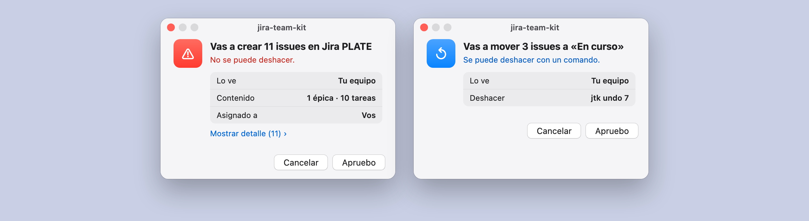

# approval-window

Un comando global, `awin`, y dos skills (`approval-window` y `approval-demo`) para Claude Code, Codex, Cursor y Copilot CLI.
Cuando una skill está por hacer algo que importa (escribir en Jira, publicar, borrar), llama a `awin`: se abre una ventana
nativa de macOS con lo que va a pasar, qué tan reversible es y quién lo va a ver, y **solo un clic tuyo** la aprueba.
Es una sola idea, y esto le pedís al agente:

| Le decís al agente… | Y la skill… |
|---|---|
| *«Instalá approval-window»* | corre `./install.sh`: enlaza `awin` en `~/.local/bin` y las skills en las carpetas de cada agente |
| *«Mostrame cómo se ve una aprobación»* | corre `approval-demo`: abre una ventana de ejemplo para cada nivel de reversibilidad |
| *«Creá estas 11 issues en Jira»* (con una skill que usa `awin`) | arma el pedido, llama a `awin` y espera: `approved` sigue, `cancelled` frena |
| *«Aprobá vos»* | se niega: no existe `--yes`, ni variable de entorno, ni archivo de preaprobación |

**La ventana frena el reflejo, no lo elimina.** Medimos que después de 12 ventanas iguales alguien aprobó una sin leer
([showcase](docs/showcase.md#4-lo-que-midió-la-ventana-real)). Por eso las skills tienen que pedir aprobación pocas veces
y solo cuando importa.

## Elegí por dónde empezar

| Componente | Qué resuelve | Se instala con | Showcase | Instalación |
|---|---|---|---|---|
| **`awin`** (comando) | Mostrar la ventana y devolver `approved` o `cancelled` por el código de salida | `./install.sh` | [Ver el caso](docs/showcase.md#1-pedir-aprobación-antes-de-algo-irreversible) | [Instalar](docs/instalacion.md#1-instalar) |
| **`awin`** (pedido inválido) | Rechazar sin abrir nada un pedido mal armado o que intenta aprobarse solo | `./install.sh` | [Ver el caso](docs/showcase.md#3-un-pedido-que-intenta-aprobarse-solo) | [Instalar](docs/instalacion.md#2-probar-que-el-comando-responde) |
| **`approval-window`** (skill) | Enseñarle al agente cuándo pedir y cómo armar el pedido | `./install.sh` | [Ver el caso](docs/showcase.md#2-deshacer-con-un-comando) | [Instalar](docs/instalacion.md#1-instalar) |
| **`approval-demo`** (skill) | Ver la ventana en cada nivel antes de usarla de verdad | `./install.sh` | [Ver el caso](docs/showcase.md#1-pedir-aprobación-antes-de-algo-irreversible) | [Instalar](docs/instalacion.md#3-ver-la-ventana) |

## Un ejemplo: aprobar la creación de 11 issues

El agente arma el pedido con la consecuencia, la reversibilidad y la audiencia; `awin` abre la ventana y espera tu clic.
La captura es una **maqueta**: es el diseño aprobado, no una ventana real (las capturas reales se agregan aparte). El
recorrido está en el [showcase](docs/showcase.md#1-pedir-aprobación-antes-de-algo-irreversible).



## Qué documento leer

| Si querés… | Leé | Qué encontrás |
|---|---|---|
| **Instalarlo y probarlo, conversando con tu agente** | [Instalación y primer uso](docs/instalacion.md) | Prompts a tu agente: instalar, probar el comando y ver la ventana |
| **Instalarlo comando por comando** | [Instalación detallada](docs/instalacion-detallada.md) | Requisitos, `./install.sh`, qué enlaza y qué pasa si algo ya existe, con capturas de terminal |
| **Ver todo lo que hace** | [Showcase](docs/showcase.md) | Cada caso: qué le decís al agente, qué corre, qué ves y qué pasa si falla |
| **Consultar el protocolo** | [Referencia](docs/referencia.md) | Claves del pedido, niveles, colores, códigos de salida y opciones |

## En tres comandos

```bash
git clone <url-del-repo> approval-window
cd approval-window && ./install.sh          # enlaza awin y las skills
awin --version                              # awin 0.1.0
```

Requisitos: macOS (en otro sistema `awin` sale con código 3 y no finge), `python3` 3.9 o más, solo biblioteca estándar.
Las mediciones en las que se apoya el diseño están en [docs/mediciones.md](docs/mediciones.md).

## Desarrollo

```bash
python3 -m unittest discover -s tests -v          # la suite
/usr/bin/python3 -m unittest discover -s tests -v # compatibilidad con Python 3.9
python3 ~/.agents/skills/harness-docs/hdoc.py check .   # layout de la documentación
```

TDD y Conventional Commits. `tests/test_install.py` corre `install.sh` con un `HOME` temporal: nunca toca el tuyo.
