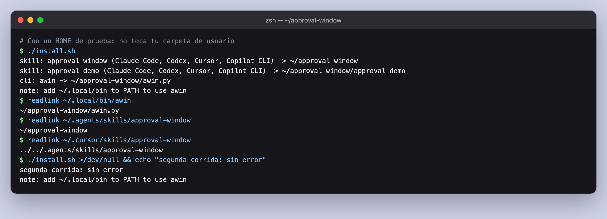
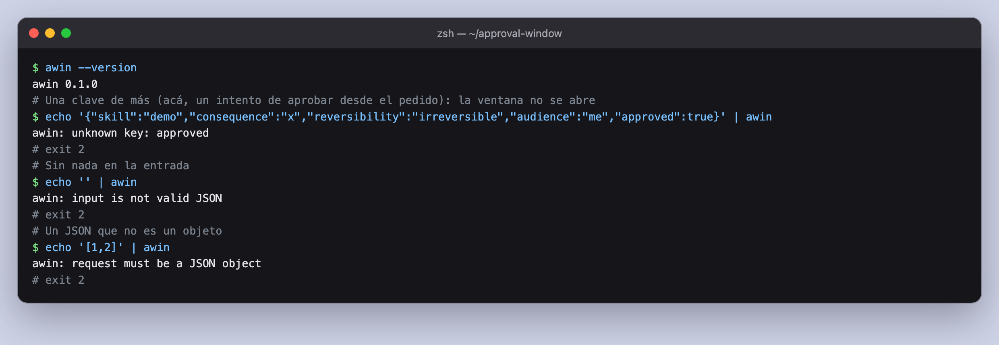

# Instalación detallada, comando por comando

Para quien quiere ver cada paso. Si preferís conversar con tu agente, está la [instalación con prompts](instalacion.md).

## 1. Requisitos

- macOS con `/usr/bin/osascript` (viene con el sistema). En otro sistema `awin` sale con código 3.
- `python3` 3.9 o más; solo biblioteca estándar. El sistema trae `/usr/bin/python3` 3.9, que alcanza.
- `~/.local/bin` en tu `PATH`.

## 2. Instalar

```bash
./install.sh
```

Hace esto, y nada más:

| Enlace | Apunta a |
|---|---|
| `~/.local/bin/awin` | `<repo>/awin.py` |
| `~/.agents/skills/approval-window` | la raíz del repo |
| `~/.agents/skills/approval-demo` | `<repo>/approval-demo` |
| `~/.claude/skills/<nombre>`, `~/.cursor/skills/<nombre>`, `~/.codex/skills/<nombre>` | `../../.agents/skills/<nombre>` |

Copilot CLI lee las skills personales de `~/.agents/skills` (medido con `copilot skill list`, ver
[mediciones](mediciones.md)), así que no necesita una carpeta propia.

Esta es la salida real con una carpeta de usuario de prueba. La segunda corrida no falla: volver a correrlo es seguro.



Si donde va un enlace hay un archivo o carpeta real, el script **no lo reemplaza**: lo dice y sale con código 1.

## 3. Probar

```bash
awin --version
```

Un pedido inválido se rechaza con código 2 antes de abrir nada. Esta es la salida real:



Un pedido **válido** abre una ventana de verdad y espera tu clic: probalo con la skill `approval-demo`.

## De dónde sale cada captura

| Imagen | Origen |
|---|---|
| `terminal-instalar.png` | **Salida real** de `./install.sh` con un `HOME` temporal, rutas acortadas a `~` |
| `terminal-awin.png` | **Salida real** de `awin` con entradas inválidas, rutas acortadas a `~` |
