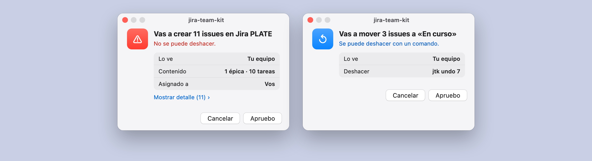
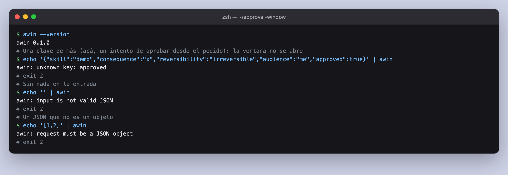

# Showcase

Cada caso: qué le decís al agente, qué corre, qué ves y qué pasa si falla. Las ventanas que ves en las imágenes son
**maquetas** del diseño aprobado; las terminales son salida real.

## Lo que lo distingue

- **Un clic humano o nada.** No hay forma de aprobar por programa: ni opción, ni variable, ni archivo.
- **Cancelar es lo que pasa por defecto.** Escape, cerrar o el tiempo vencido devuelven `cancelled` (código 1); si la
  ventana no se pudo mostrar o falló, el código es 3. Nunca `approved`.
- **La skill manda datos, la ventana decide cómo se ven.** Todo texto se escapa; no se ejecuta nada de lo que se muestre.
- **Dice qué tan reversible es.** Cuatro niveles, cada uno con su color y su texto.

## 1. Pedir aprobación antes de algo irreversible

**Le decís:** «Creá estas 11 issues en Jira PLATE», con una skill que usa `awin`.

**Qué corre:** la skill arma un pedido con `reversibility: "irreversible"`, `audience: "team"` y un `summary`, y lo manda a
`awin` por stdin.

**Qué ves:** una ventana roja con el título de la skill, la consecuencia, «No se puede deshacer.», quién lo ve y un
«Mostrar detalle». Suena un `NSBeep`.

*Maqueta: el diseño aprobado, no una ventana real.*

**Si falla:** si cancelás, cerrás o pasan 100 s, `awin` sale con 1 y la skill no hace nada.

## 2. Deshacer con un comando

**Le decís:** «Pasá estos 3 issues a En curso».

**Qué corre:** pedido con `reversibility: "reversible_planned"` y `undo: "jtk undo 7"`.

**Qué ves:** la ventana azul de la derecha, con el comando para deshacer como una fila. Sin `undo`, `awin` la muestra como
`reversible_manual` y avisa por stderr.

**Si falla:** igual que el caso 1.

## 3. Un pedido que intenta aprobarse solo

**Le decís:** nada; es lo que pasa si un pedido trae `"approved": true` o `"yes": true`.

**Qué corre:** `awin` rechaza las claves desconocidas antes de abrir nada. Salida real:

**Qué ves:** una línea por stderr y código 2; ninguna ventana.

**Si falla:** no hay nada que falle: el rechazo es el resultado.

## 4. Lo que midió la ventana real

En la verificación a mano de la ventana (2026-10-23), después de **12 ventanas idénticas** (4 niveles por 3 estilos), la
persona hizo clic en Apruebo **sin leer** la siguiente. Es justo el reflejo que el proyecto quiere frenar. En el segundo
intento, Enter no hizo nada, Tab+Espacio no aprobó y Escape canceló (detalle en [mediciones](mediciones.md)).

**La lección:** la ventana sola no alcanza. **Las skills tienen que pedir aprobación pocas veces y solo cuando importa**:
una ventana por acción que no se puede deshacer, no una por cada paso.

## Lo que te protege y lo que no

| Te protege de | No te protege de |
|---|---|
| Una skill que actúa sin que nadie la vea | Aprobar sin leer (medido arriba) |
| Un pedido que intenta aprobarse solo (código 2) | Una skill que no llama a `awin` antes de actuar |
| Texto con HTML o scripts en el pedido (se muestra literal) | Que la consecuencia que la skill describe no sea la real |
